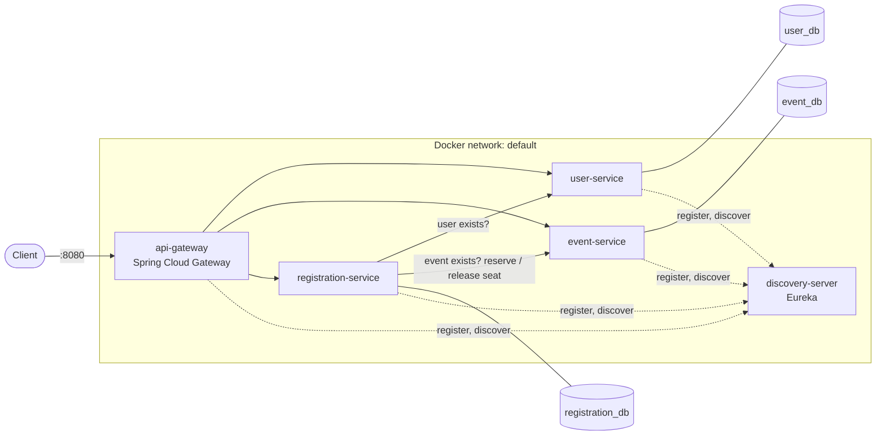

# Event Management Platform

[](https://github.com/kardiguemagassa/event-management-platform/actions/workflows/ci.yml)
[](https://github.com/kardiguemagassa/event-management-platform/releases)
[](https://hub.docker.com/u/kardigue)

Microservices platform to manage users, events and registrations, with seat reservation across services.
Built with Spring Boot 4 and Spring Cloud, containerised with Docker, tested and delivered by GitHub Actions.

## Overview

| Service | Responsibility |
|---|---|
| `api-gateway` | Single entry point: routing, circuit breakers with fallback, one Swagger UI for every service |
| `discovery-server` | Eureka registry: services find each other by name |
| `user-service` | Users, with a unique e-mail address |
| `event-service` | Events, their lifecycle (published, cancelled) and capacity, with idempotent seat reservation |
| `registration-service` | Registers a user to an event by orchestrating `user-service` and `event-service` |

## Architecture



Each database sits on a private network shared with its own service only. Only the gateway (8080) and Eureka (8761)
publish a port, bound to `127.0.0.1`.

## Tech stack

| Area | Choice |
|---|---|
| Language and framework | Java 21, Spring Boot 4.1, Spring MVC (virtual threads) and Spring WebFlux (gateway) |
| Microservices | Spring Cloud 2025.1: Gateway, Netflix Eureka, LoadBalancer, CircuitBreaker (Resilience4j) |
| Persistence | PostgreSQL 18, Spring Data JPA (Hibernate 7), Flyway |
| API | REST, RFC 9457 problem details, OpenAPI 3 (springdoc), Bean Validation |
| Tests | JUnit 5, AssertJ, Mockito, Testcontainers, JaCoCo |
| Delivery | Docker (multi-stage, multi-platform), Docker Compose, GitHub Actions, Trivy, Dependabot |

## Design decisions

| Decision | Why |
|---|---|
| One database per service, each on a private network | A service owns its data; no other service can reach its database, not even through the network |
| Synchronous saga in `registration-service`, with compensation | User check, event check, seat reservation, then the registration is saved; if saving fails, the seat is released. No distributed transaction, and no HTTP call inside a database transaction |
| Idempotent seat reservation (reservation id = registration id) | A retried reserve or release never counts twice |
| Partial unique index on (event, user) for confirmed registrations | Duplicates are rejected by the database itself, even under concurrent requests (covered by a concurrency test) |
| Retry, then circuit breaker, per downstream service | Fast transient failures are retried once; a failing service is cut off and answered with `503` in milliseconds. Business answers (`404`, `409`) are not failures |
| "No instance available" ignored by the circuit breaker | No request is sent, so there is nothing to protect; counting it made recovery fail while discovery caught up ([#10](https://github.com/kardiguemagassa/event-management-platform/issues/10)) |
| Gateway as the only entry point, with a fallback | Services publish no port; an unavailable service is answered with a `503` problem, never a raw error |
| RFC 9457 problem details with a stable `code` | Clients branch on `code`, never on human-readable messages |
| Lightweight hexagonal architecture | Domain and application code do not depend on HTTP or JPA; adapters are replaceable and tested on their own |
| Version taken from the Git tag (CI-friendly `${revision}`) | One source of truth for image tags, jar names and `/actuator/info` |

## API

Every endpoint is reached through the gateway, `http://localhost:8080`, and documented in a single Swagger UI:
`http://localhost:8080/swagger-ui.html` (one definition per service).

| Resource | Endpoints |
|---|---|
| Users | `GET` `POST` `/api/users`, `GET` `PUT` `DELETE` `/api/users/{id}` |
| Events | `GET` `POST` `/api/events`, `GET` `PUT` `DELETE` `/api/events/{id}`, `POST /api/events/{id}/publish`, `POST /api/events/{id}/cancel`, `POST /api/events/{id}/capacity/reserve` and `.../release` (used by `registration-service`) |
| Registrations | `POST /api/registrations`, `GET /api/registrations/{id}`, `POST /api/registrations/{id}/cancel`, `GET /api/registrations/users/{userId}`, `GET /api/registrations/events/{eventId}` |

Errors are RFC 9457 problem details with a stable `code` (the HTTP status of each case is listed in the Swagger UI):

| Category | Codes |
|---|---|
| Not found | `USER_NOT_FOUND`, `EVENT_NOT_FOUND`, `REGISTRATION_NOT_FOUND` |
| Business rules | `ALREADY_REGISTERED`, `EVENT_FULL`, `EVENT_NOT_REGISTRABLE`, `REGISTRATION_ALREADY_CANCELLED`, `EMAIL_ALREADY_USED`, `INVALID_EVENT_STATE`, `EVENT_HAS_RESERVATIONS`, `CAPACITY_BELOW_RESERVED`, `RESERVATION_ID_CONFLICT`, `CONCURRENT_MODIFICATION` |
| Invalid request | `VALIDATION_FAILED`, `INVALID_SORT_PROPERTY`, `EVENT_START_NOT_IN_FUTURE` |
| Availability | `DOWNSTREAM_UNAVAILABLE` (a dependency of `registration-service`), `SERVICE_UNAVAILABLE` and `UPSTREAM_TIMEOUT` (gateway fallback), `INTERNAL_ERROR` |

## Running locally

Prerequisites: Java 21 and Docker with Compose v2. Create your local configuration once:

```bash
cp .env.example .env   # then set your own values; .env is git-ignored and must never be committed
```

### Option 1: whole platform in Docker

```bash
docker compose --profile app up -d --build
docker compose --profile app ps          # wait until the 8 containers are (healthy)
```

| URL                                     | Purpose                                            |
|-----------------------------------------|----------------------------------------------------|
| `http://localhost:8080`                 | API Gateway, the single entry point                |
| `http://localhost:8080/swagger-ui.html` | Swagger UI of all services (Select a definition)   |
| `http://localhost:8761`                 | Eureka dashboard                                   |

Published ports are bound to `127.0.0.1` only. The services publish no port: they are reachable through the gateway.

### Option 2: databases in Docker, services from the IDE

```bash
docker compose up -d                     # databases only (ports 5433, 5434, 5435)
```

Then start `discovery-server` first, followed by the other services. The aggregated Swagger UI works here too
(`http://localhost:8080/swagger-ui.html`), and each service also serves its own, for example
`http://localhost:8083/swagger-ui/index.html`.

> Do not run both options at the same time. Containers publish on `127.0.0.1` while the IDE binds every
> interface, so both can hold the same port and register in the same Eureka, which mixes the instances.
> Stop one option before starting the other (`docker compose --profile app stop`).

### End-to-end smoke test

```bash
./scripts/e2e-docker.sh
```

Runs against Option 1, through the gateway only: nominal registration, duplicate (`409 ALREADY_REGISTERED`),
full event (`409 EVENT_FULL`), `event-service` outage (fast `503` once the circuit is open, gateway fallback),
recovery after restart, and no seat leaked.

### Docker setup at a glance

- One multi-stage `Dockerfile` for every module (`--build-arg MODULE=...`): layered jar, Maven cache mount, non-root user.
- `docker` Spring profile: unique Eureka instance id, service name announced instead of an IP, short discovery
  intervals (development values; production keeps the defaults).
- One private network per service and its database: a database is reachable by its owner only.
- Health checks on `/actuator/health/readiness`, used to order the startup.

### Running a published release

Every merge to `main` and every `vX.Y.Z` tag publishes images for `linux/amd64` and `linux/arm64` to Docker Hub as
`kardigue/event-platform-<service>`, tagged `X.Y.Z`, `X.Y` and `latest` (releases only), `main` and `sha-<commit>`.
Each image is scanned with Trivy (no fixable critical vulnerability) and carries an SBOM and build provenance.

```bash
export IMAGE_NAMESPACE=kardigue IMAGE_TAG=0.2.0
docker compose --profile app pull
docker compose --profile app up -d --no-build
```

### Stopping

```bash
docker compose --profile app down        # keeps the data volumes
docker compose --profile app down -v     # also deletes the databases
```

## Testing

| Level | Tools | Scope |
|---|---|---|
| Unit | JUnit 5, AssertJ, Mockito | Domain rules, application services, HTTP adapters, the circuit breaker configuration on a real Resilience4j breaker |
| Integration (`*IT`) | Testcontainers (PostgreSQL 18), JDK HTTP server as fake downstream services | Repositories and Flyway migrations, concurrent registrations, retry and circuit breaker, gateway routing and fallback, API docs |
| End to end | `scripts/e2e-docker.sh` | The whole platform in Docker, through the gateway only, including an outage and the recovery of `event-service` |

`./mvnw verify` runs the unit and integration tests (Docker is required for Testcontainers) and the coverage checks.
JaCoCo measures unit and integration tests together; each module has a floor just below its measured coverage, so
coverage can only go up:

| Module | Lines | Branches |
|---|---|---|
| `api-gateway` | 96 % | 63 % |
| `user-service` | 98 % | 84 % |
| `event-service` | 98 % | 84 % |
| `registration-service` | 94 % | 86 % |

## CI/CD and supply chain

| Workflow | Trigger | What it does |
|---|---|---|
| `ci.yml` | Pull request to `dev` or `main`, push to `dev` | `build`: `./mvnw verify`, coverage table on the run page, reports as artifacts. `e2e`: the whole platform in Docker and the end-to-end scenario |
| `release.yml` | Push to `main`, tag `vX.Y.Z` | Tests again, then for each image: build, Trivy scan (fails on any fixable critical vulnerability), build for `linux/amd64` and `linux/arm64`, push to Docker Hub with SBOM and provenance |
| Dependabot | Weekly | Pull requests against `dev` for Maven dependencies, GitHub Actions and Docker base images |

- Every action is pinned by commit SHA; workflow tokens are read-only (`contents: read`).
- Rulesets on `dev` and `main`: changes through pull requests only, `build` and `e2e` required, no force push, no deletion.
- CI databases use throwaway passwords generated per run; the Docker Hub token is scoped to read and write, expires,
  and lives in the repository secrets only.

### Release process

1. Features go through pull requests to `dev`.
2. A pull request from `dev` to `main` (`release: X.Y.Z`) is merged with a merge commit: images `main` and `sha-<commit>`.
3. Tag and release:

   ```bash
   git tag -a vX.Y.Z origin/main -m "vX.Y.Z: <summary>"
   git push origin vX.Y.Z
   gh release create vX.Y.Z --verify-tag --generate-notes
   ```

   The tag publishes `X.Y.Z`, `X.Y` and `latest`.

release-please was considered and left out: it targets a single branch, and with the `dev` to `main` flow its release
pull request would change `main` directly and require merging `main` back into `dev` after every release.

## Known limitations

- **Saga without an outbox**: if `registration-service` stops between the seat reservation and the save of the
  registration, the seat stays reserved. A transactional outbox with a message broker would make the saga reliable.
- **No authentication**: the API is open (see Roadmap).
- **Client-side discovery**: after a restart, callers may get `503` for a few seconds, until Eureka and the load
  balancer caches catch up (short intervals in the `docker` profile; production defaults are longer).
- **Swagger UI is always enabled**: it should be disabled in production (`springdoc.swagger-ui.enabled=false`).
- **Gateway branch coverage is 64 %**: the error branches of its filters are the next tests to write.

## Roadmap

- **Security**: OAuth2 resource server at the gateway with Keycloak (JWT), token relayed to the services.
- **Observability**: OpenTelemetry traces across the gateway and the services (Grafana Tempo or Jaeger), metrics.
- **Reliability**: transactional outbox and messaging for the registration saga.
- **Frontend**: Angular application served by nginx, proxying `/api` to the gateway (same origin, no CORS), with a
  TypeScript client generated from the OpenAPI specifications.
