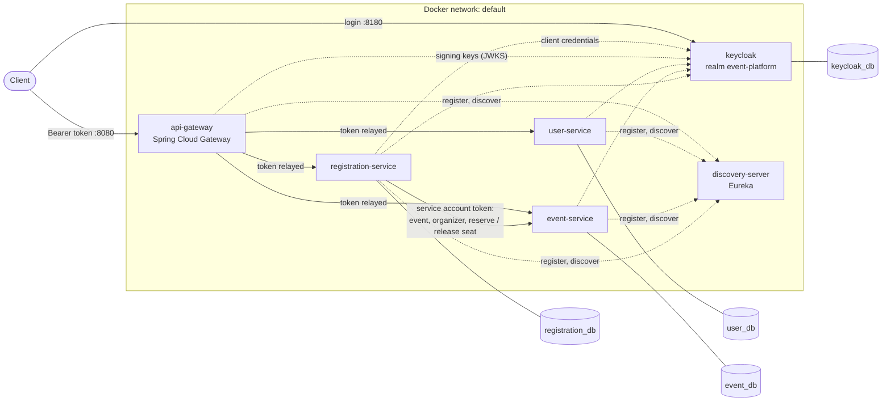

# Event Management Platform

[](https://github.com/kardiguemagassa/event-management-platform/actions/workflows/ci.yml)
[](https://github.com/kardiguemagassa/event-management-platform/releases)
[](https://hub.docker.com/u/kardigue)

Microservices platform to manage events and registrations, with seat reservation across services, secured with
Keycloak (OAuth2, JWT). Built with Spring Boot 4 and Spring Cloud, containerised with Docker, tested and delivered by
GitHub Actions.

## Overview

| Service | Responsibility |
|---|---|
| `api-gateway` | Single entry point: token validation, routing, circuit breakers with fallback, one Swagger UI for every service |
| `discovery-server` | Eureka registry: services find each other by name |
| `user-service` | Application profiles of the users (`/api/users/me`), keyed by their Keycloak id |
| `event-service` | Events, their lifecycle (draft, published, cancelled), their organizer and capacity, with idempotent seat reservation |
| `registration-service` | Registers the authenticated user to an event, reserving a seat in `event-service` with its own service account |
| `keycloak` | Identity provider: sign-up and login, roles, access tokens (realm `event-platform`) |
| `platform-security` | Shared library (not a service): resource server setup of the servlet services, test token helpers |
| `platform-observability` | Shared library (not a service): OpenTelemetry tracing without the noise, trace id in error responses |
| `otel-lgtm` | Observability backend for development: OpenTelemetry collector, Tempo (traces), Prometheus (metrics), Loki, Grafana |

## Architecture



Each database sits on a private network shared with its own service only. Only the gateway (8080), Keycloak (8180),
Eureka (8761) and the observability backend (Grafana 3000, OTLP 4318, Tempo 3200) publish a port, bound to
`127.0.0.1`. Every service sends its traces and metrics to the collector over OTLP (not drawn).

## Tech stack

| Area | Choice |
|---|---|
| Language and framework | Java 21, Spring Boot 4.1, Spring MVC (virtual threads) and Spring WebFlux (gateway) |
| Microservices | Spring Cloud 2025.1: Gateway, Netflix Eureka, LoadBalancer, CircuitBreaker (Resilience4j) |
| Persistence | PostgreSQL 18, Spring Data JPA (Hibernate 7), Flyway |
| API | REST, RFC 9457 problem details, OpenAPI 3 (springdoc), Bean Validation |
| Security | Keycloak 26 (OpenID Connect), Spring Security 7: OAuth2 resource server (JWT, RS256) and OAuth2 client (client credentials) |
| Observability | OpenTelemetry (Spring Boot starter, Micrometer Tracing), W3C trace context, OTLP; Grafana, Tempo, Prometheus, Loki (`grafana/otel-lgtm`) in development |
| Tests | JUnit 5, AssertJ, Mockito, Testcontainers, JaCoCo |
| Delivery | Docker (multi-stage, multi-platform), Docker Compose, GitHub Actions, Trivy, Dependabot |

## Design decisions

| Decision | Why |
|---|---|
| One database per service, each on a private network | A service owns its data; no other service can reach its database, not even through the network |
| Synchronous saga in `registration-service`, with compensation | Event check, seat reservation, then the registration is saved; if saving fails, the seat is released. No distributed transaction, and no HTTP call inside a database transaction |
| Idempotent seat reservation (reservation id = registration id) | A retried reserve or release never counts twice |
| Partial unique index on (event, user) for confirmed registrations | Duplicates are rejected by the database itself, even under concurrent requests (covered by a concurrency test) |
| Retry, then circuit breaker, per downstream service | Fast transient failures are retried once; a failing service is cut off and answered with `503` in milliseconds. Business answers (`404`, `409`) are not failures |
| "No instance available" ignored by the circuit breaker | No request is sent, so there is nothing to protect; counting it made recovery fail while discovery caught up ([#10](https://github.com/kardiguemagassa/event-management-platform/issues/10)) |
| Gateway as the only entry point, with a fallback | Services publish no port; an unavailable service is answered with a `503` problem, never a raw error |
| RFC 9457 problem details with a stable `code` | Clients branch on `code`, never on human-readable messages |
| Lightweight hexagonal architecture | Domain and application code do not depend on HTTP or JPA; adapters are replaceable and tested on their own |
| Version taken from the Git tag (CI-friendly `${revision}`) | One source of truth for image tags, jar names and `/actuator/info` |
| Keycloak as identity provider, user-service as profile store | Credentials, e-mail and roles stay in a dedicated, standard component; the services keep only what the business needs, keyed by the token's `sub` |
| Tokens validated at the gateway **and** in every service | Zero trust: the gateway rejects early, each service enforces its own rules and never trusts the network |
| Keys from the internal JWK set, public issuer and audience checked | No discovery call at startup; a token from another realm or for another audience is rejected |
| Identity taken from the token, never from the request | Closes IDOR: a registration is made for the caller, a profile is the caller's own, an event belongs to its creator |
| Roles for actions, ownership for objects | `ORGANIZER` may change events, but only their own (403); objects of others that are private do not exist for the caller (404) |
| Client credentials for service-to-service calls | `registration-service` reserves seats with its own identity (`SEAT_MANAGER`), not the user's; the token is cached and renewed |
| Shared `platform-security` library, imported explicitly | One implementation of token validation, role mapping and 401/403 problems; each service keeps its own access rules |
| OpenTelemetry through Spring Boot's starter, no Java agent | Vendor-neutral standard (OTLP): the backend can become Datadog, Dynatrace or Elastic without code change; nothing to add to the images |
| Noise dropped before export | Health probes, Eureka heartbeats and Spring Security filter spans would bury the business traces at 100 % sampling |
| Trace id in every problem response | The id a client reports leads straight to the trace and to the matching log lines |

## Security

Keycloak issues the access tokens (realm `event-platform`); every call to `/api` carries one as a bearer token,
except reads of the public event catalog. Sign-up is open and gives the `ATTENDEE` role; other roles are granted in
the Keycloak admin console.

| Role | Granted to | Allows |
|---|---|---|
| `ATTENDEE` | every new user (default role) | registering to events, cancelling one's own registrations |
| `ORGANIZER` | by an administrator | creating events, and changing, publishing, cancelling or deleting one's own |
| `SEAT_MANAGER` | the `registration-service` service account only | reserving and releasing seats |
| `ADMIN` | by an administrator | reading and deleting any user profile |

| Route | Access |
|---|---|
| `GET /api/events`, `GET /api/events/{id}` | public; a draft is visible to its organizer only |
| other `/api/events/**` | `ORGANIZER`, and organizer of the event for changes (`403 NOT_EVENT_ORGANIZER`) |
| `/api/events/{id}/capacity/**` | `SEAT_MANAGER`; closed at the gateway |
| `POST /api/registrations`, `POST /api/registrations/{id}/cancel` | `ATTENDEE`, own registrations only (others are `404`) |
| `GET /api/registrations/me`, `GET /api/registrations/{id}` | authenticated, own registrations only |
| `GET /api/registrations/events/{eventId}` | `ORGANIZER` of that event |
| `GET` `PUT` `DELETE /api/users/me` | authenticated, one's own profile |
| `GET /api/users`, `GET` `DELETE /api/users/{id}` | `ADMIN` |

Clients: `event-platform-web` (public, Authorization Code with PKCE, for the future front-end) and
`registration-service` (confidential, client credentials, its secret comes from `.env`). The access tokens carry the
audience `event-platform-api`, checked by every service.

## Observability

Each request gets a trace, propagated with the W3C `traceparent` header from the gateway to the services
(load-balanced `RestClient` included). Traces, metrics and logs are exported over OTLP. In development, everything goes
to `grafana/otel-lgtm`:

| URL | Purpose |
|---|---|
| `http://localhost:3000` | Grafana (`admin` / `admin`): **Explore**, data source **Tempo**, search by service or paste a trace id |
| `http://localhost:3200/api/traces/<traceId>` | Tempo API, used by the end-to-end test |
| `http://localhost:3100/loki/api/v1/query_range` | Loki API, used by the end-to-end test |

- **Spans**: gateway, services, calls between services, and one span per SQL query (`datasource-micrometer`, query text
  without parameter values). Health probes, Eureka calls and Spring Security internals are filtered out.
- **Logs**: every line carries `[traceId-spanId]` on the console, and is sent to Loki with its trace and span ids
  (OpenTelemetry Logback appender, installed by `platform-observability`: no `logback-spring.xml` per service). In
  Grafana, **Explore**, data source **Loki**: `{service_name="registration-service"} | trace_id="<traceId>"`, or from a
  trace in Tempo, the logs of a span. `registration-service` logs each confirmed and cancelled registration (ids only).
- **Errors**: every problem answered by a service carries `traceId`, for example
  `{"code": "DOWNSTREAM_UNAVAILABLE", "traceId": "4bf92f3577b34da6a3ce929d0e0e4736", ...}`.
- **Sampling**: `TRACING_SAMPLING_PROBABILITY`, 10 % by default (production), 100 % in compose and `.env.example`.
- **Metrics**: exported over OTLP to Prometheus. Three dashboards, versioned in `observability/grafana/dashboards` and
  provisioned at startup (Grafana, **Dashboards**, folder **Event Platform**; read-only, edited in the repository):
  - **Services**: request rate, 5xx rate, latency p95 and p99 per service, slowest routes, responses by status, heap,
    CPU, GC, database connections (Hikari);
  - **Resilience**: state of every circuit breaker over time (closed, half-open, open), failure rate, calls rejected
    while open, gateway fallbacks and timeouts, downstream calls of `registration-service`;
  - **Business**: registrations confirmed, cancelled and rejected by reason (`EVENT_FULL`, `ALREADY_REGISTERED`...),
    counted by `registration-service` (`registrations_*_total`).

  Metrics are pushed every 10 s in compose (`OTEL_METRICS_STEP`), every minute by default.

  A stopped service leaves discovery within seconds: callers then fail fast without calling it, and the breakers ignore
  that case by design (no request was sent), so they stay closed. To see a breaker open, make the service hang instead:
  `docker compose pause event-service`, register a few times, then `docker compose unpause event-service`.
- **Alerts** (`observability/grafana/alerting.yaml`, Grafana **Alerting**): more than 5 % of 5xx on a service for
  2 minutes, calls rejected by an open circuit breaker for 2 minutes (a sustained outage under traffic). A
  half-open breaker alone is not alerted: without traffic it stays half-open after the downstream has recovered,
  which is not an incident. No contact point in development; production would route them
  to the on-call channel.

## API

Every endpoint is reached through the gateway, `http://localhost:8080`, and documented in a single Swagger UI:
`http://localhost:8080/swagger-ui.html` (one definition per service).
To call a protected endpoint from it, click **Authorize**, then **Authorize** again in the `keycloak` dialog and
sign in with a Keycloak account: the Swagger UI uses the public client `event-platform-web` (authorization code
with PKCE) and sends the access token on every "Try it out". The services' own Swagger UIs (for example
`http://localhost:8083/swagger-ui/index.html`) show the scheme but cannot sign in: their address is not a redirect
URI of the client.

| Resource | Endpoints |
|---|---|
| Users (profiles) | `GET` `PUT` `DELETE` `/api/users/me`, `GET /api/users`, `GET` `DELETE` `/api/users/{id}` |
| Events | `GET` `POST` `/api/events`, `GET` `PUT` `DELETE` `/api/events/{id}`, `POST /api/events/{id}/publish`, `POST /api/events/{id}/cancel`, `POST /api/events/{id}/capacity/reserve` and `.../release` (used by `registration-service`) |
| Registrations | `POST /api/registrations`, `GET /api/registrations/me`, `GET /api/registrations/{id}`, `POST /api/registrations/{id}/cancel`, `GET /api/registrations/events/{eventId}` |

Errors are RFC 9457 problem details with a stable `code` (the HTTP status of each case is listed in the Swagger UI):

| Category | Codes |
|---|---|
| Security | `UNAUTHENTICATED` (401), `ACCESS_DENIED` (403, missing role), `NOT_EVENT_ORGANIZER` (403, not the owner) |
| Not found | `USER_NOT_FOUND`, `EVENT_NOT_FOUND`, `REGISTRATION_NOT_FOUND` |
| Business rules | `ALREADY_REGISTERED`, `EVENT_FULL`, `EVENT_NOT_REGISTRABLE`, `REGISTRATION_ALREADY_CANCELLED`, `EMAIL_ALREADY_USED`, `INVALID_EVENT_STATE`, `EVENT_HAS_RESERVATIONS`, `CAPACITY_BELOW_RESERVED`, `RESERVATION_ID_CONFLICT`, `CONCURRENT_MODIFICATION` |
| Invalid request | `VALIDATION_FAILED`, `INVALID_SORT_PROPERTY`, `EVENT_START_NOT_IN_FUTURE`, `EMAIL_CLAIM_MISSING` |
| Availability | `DOWNSTREAM_UNAVAILABLE` (a dependency of `registration-service`), `SERVICE_UNAVAILABLE` and `UPSTREAM_TIMEOUT` (gateway fallback), `INTERNAL_ERROR` |

## Running locally

Prerequisites: Java 21 and Docker with Compose v2. Create your local configuration once:

```bash
cp .env.example .env   # then set your own values; .env is git-ignored and must never be committed
```

`.env` holds the database credentials, the Keycloak admin account and the secret of the `registration-service`
client. The realm is imported from `keycloak/realm-event-platform.json` at the first start of Keycloak only: after
a change of that file, recreate its volume (`docker volume rm event-platform_keycloak-db-data`).

### Option 1: whole platform in Docker

```bash
docker compose --profile app up -d --build
docker compose --profile app ps          # wait until the 11 containers are (healthy)
```

| URL                                     | Purpose                                            |
|-----------------------------------------|----------------------------------------------------|
| `http://localhost:8080`                 | API Gateway, the single entry point                |
| `http://localhost:8080/swagger-ui.html` | Swagger UI of all services (Select a definition)   |
| `http://localhost:8761`                 | Eureka dashboard                                   |
| `http://localhost:8180/admin`           | Keycloak admin console (account from `.env`)       |
| `http://localhost:3000`                 | Grafana: traces (Tempo), metrics, logs             |

Published ports are bound to `127.0.0.1` only. The services publish no port: they are reachable through the gateway.

### Option 2: databases in Docker, services from the IDE

```bash
docker compose up -d                     # databases (5433, 5434, 5435), Keycloak (8180), otel-lgtm (3000, 4318)
```

Then start `discovery-server` first, followed by the other services. The aggregated Swagger UI works here too
(`http://localhost:8080/swagger-ui.html`), and each service also serves its own, for example
`http://localhost:8083/swagger-ui/index.html`.

> Do not run both options at the same time. Containers publish on `127.0.0.1` while the IDE binds every
> interface, so both can hold the same port and register in the same Eureka, which mixes the instances.
> Stop one option before starting the other (`docker compose --profile app stop`).

### Calling the API with a token

The public client only supports the browser login flow (Authorization Code with PKCE). For calls from a terminal,
the end-to-end script shows the whole recipe: it creates a test client with the password grant and test users
through the Keycloak admin API, then deletes them on exit. Such a client must never exist outside development.

### End-to-end smoke test

```bash
./scripts/e2e-docker.sh
```

Runs against Option 1, through the gateway only, with real Keycloak tokens (34 checks):

- API documentation: each OpenAPI document declares the Keycloak OAuth2 scheme (Swagger UI login);
- profiles: created with `PUT /api/users/me`, e-mail taken from the token, `ADMIN` required to list users, erasure;
- security: anonymous call, malformed token and token of another realm (`401`), internal capacity route (`403`),
  private draft (`404`), another organizer changing an event (`403`) or listing its registrations (`403`), another
  attendee cancelling a registration (`404`);
- business rules: registration, duplicate (`409 ALREADY_REGISTERED`), full event, cancellation;
- resilience: `event-service` outage (fast `503` once the instance has left discovery, gateway fallback), recovery after restart,
  and no seat leaked;
- tracing: a request started in a known trace reaches Tempo with the spans of the gateway, `registration-service` and
  `event-service` and its SQL query, an error response carries the id of its trace, and the log of a request
  reaches Loki with its trace id;
- dashboards: the three are provisioned in Grafana and the HTTP metrics of the 4 services, with the names and labels the
  dashboards read, are found in Prometheus.
- business metrics and alerts: confirmed registrations and `EVENT_FULL` rejections are counted in Prometheus, and both
  alert rules are loaded in Grafana.

### Docker setup at a glance

- One multi-stage `Dockerfile` for every module (`--build-arg MODULE=...`): layered jar, Maven cache mount, non-root user.
- `docker` Spring profile: unique Eureka instance id, service name announced instead of an IP, short discovery
  intervals (development values; production keeps the defaults).
- One private network per service and its database: a database is reachable by its owner only.
- Health checks on `/actuator/health/readiness`, used to order the startup.

### Running a published release

Every merge to `main` and every `vX.Y.Z` tag publishes images for `linux/amd64` and `linux/arm64` to Docker Hub as
`kardigue/event-platform-<service>`, tagged `X.Y.Z`, `X.Y` and `latest` (releases only), `main` and `sha-<commit>`.
Each image is scanned with Trivy (no fixable critical vulnerability) and carries an SBOM and build provenance.

```bash
export IMAGE_NAMESPACE=kardigue IMAGE_TAG=0.3.0
docker compose --profile app pull
docker compose --profile app up -d --no-build
```

### Stopping

```bash
docker compose --profile app down        # keeps the data volumes
docker compose --profile app down -v     # also deletes the databases
```

## Testing

| Level | Tools | Scope |
|---|---|---|
| Unit | JUnit 5, AssertJ, Mockito, Spring Security Test | Domain rules (ownership, visibility), application services, HTTP adapters and access rules, the circuit breaker configuration on a real Resilience4j breaker |
| Integration (`*IT`) | Testcontainers (PostgreSQL 18), JDK HTTP server as fake downstream services and fake Keycloak | Repositories and Flyway migrations, concurrent registrations and profile saves, retry and circuit breaker, gateway routing and fallback, token validation with real signed tokens (expired, other issuer or audience, unknown key), client credentials, API docs |
| End to end | `scripts/e2e-docker.sh` | The whole platform in Docker with a real Keycloak, through the gateway only, including an outage and the recovery of `event-service` |

`./mvnw verify` runs the unit and integration tests (Docker is required for Testcontainers) and the coverage checks.
JaCoCo measures unit and integration tests together; each module has a floor just below its measured coverage, so
coverage can only go up:

| Module | Lines | Branches |
|---|---|---|
| `platform-security` | 90 % | 80 % |
| `platform-observability` | 90 % | 80 % |
| `api-gateway` | 96 % | 63 % |
| `user-service` | 98 % | 84 % |
| `event-service` | 98 % | 84 % |
| `registration-service` | 94 % | 86 % |

## CI/CD and supply chain

| Workflow | Trigger | What it does |
|---|---|---|
| `ci.yml` | Pull request to `dev` or `main`, push to `dev` | `build`: `./mvnw verify`, coverage table on the run page, reports as artifacts. `e2e`: the whole platform in Docker and the end-to-end scenario |
| `release.yml` | Push to `main`, tag `vX.Y.Z` | Tests again, then for each image: build, Trivy scan (fails on any fixable critical vulnerability), build for `linux/amd64` and `linux/arm64`, push to Docker Hub with SBOM and provenance |
| Dependabot | Weekly | Pull requests against `dev` for Maven dependencies, GitHub Actions and Docker base images |

- Every action is pinned by commit SHA; workflow tokens are read-only (`contents: read`).
- Rulesets on `dev` and `main`: changes through pull requests only, `build` and `e2e` required, no force push, no deletion.
- CI uses throwaway database passwords, Keycloak admin password and client secret generated (and masked) per run;
  the Docker Hub token is scoped to read and write, expires, and lives in the repository secrets only.

### Release process

1. Features go through pull requests to `dev`.
2. A pull request from `dev` to `main` (`release: X.Y.Z`) is merged with a merge commit: images `main` and `sha-<commit>`.
3. Tag and release:

   ```bash
   git tag -a vX.Y.Z origin/main -m "vX.Y.Z: <summary>"
   git push origin vX.Y.Z
   gh release create vX.Y.Z --verify-tag --generate-notes
   ```

   The tag publishes `X.Y.Z`, `X.Y` and `latest`.

release-please was considered and left out: it targets a single branch, and with the `dev` to `main` flow its release
pull request would change `main` directly and require merging `main` back into `dev` after every release.

## Known limitations

- **Saga without an outbox**: if `registration-service` stops between the seat reservation and the save of the
  registration, the seat stays reserved. A transactional outbox with a message broker would make the saga reliable.
- **Keycloak in development mode**: `start-dev`, plain HTTP and an embedded admin account; production needs `start`
  behind TLS, a fixed hostname and an external database for high availability.
- **No administrator by default**: `ORGANIZER` and `ADMIN` are granted by hand in the Keycloak console.
- **Events created before ownership** (migration V3) have no organizer and can no longer be changed.
- **`otel-lgtm` is a development backend**: one container, no persistence, default Grafana account. Production would
  run a collector and the backends separately (or send OTLP to a vendor).
- **Errors raised by the gateway itself** (its 401 and its fallback `503`) do not carry the trace id yet; the gateway
  logs do.
- **Calls to Keycloak are not traced**: Spring Security fetches tokens and signing keys with its own HTTP clients.
- **Incoming `traceparent` headers are trusted** at the edge; a public deployment would restart traces at the gateway.
- **Client-side discovery**: after a restart, callers may get `503` for a few seconds, until Eureka and the load
  balancer caches catch up (short intervals in the `docker` profile; production defaults are longer).
- **Swagger UI is always enabled**: it should be disabled in production (`springdoc.swagger-ui.enabled=false`).
- **Gateway branch coverage is 64 %**: the error branches of its filters are the next tests to write.

## Roadmap

- **Backend for Frontend**: with the Angular front-end, the gateway also becomes an OAuth2 client (login, session
  cookie, token relay to the services), so that no token is ever stored in the browser.
- **Observability**: trace id in the gateway's own errors, alert routing to an on-call channel.
- **Keycloak login theme**: the sign-in and registration pages styled like the Angular front-end (Keycloakify or a
  FreeMarker/CSS theme), still served by Keycloak.
- **Reliability**: transactional outbox and messaging for the registration saga.
- **Frontend**: Angular application served by nginx, proxying `/api` to the gateway (same origin, no CORS), with a
  TypeScript client generated from the OpenAPI specifications and login through the gateway (BFF).
